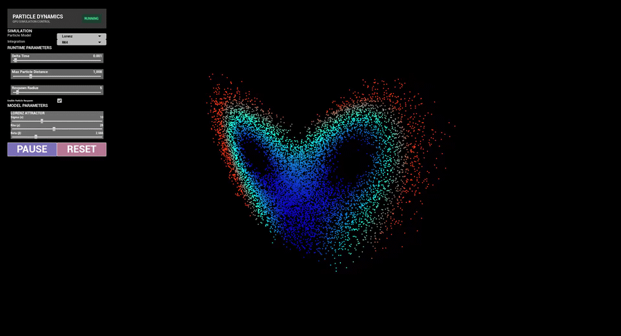
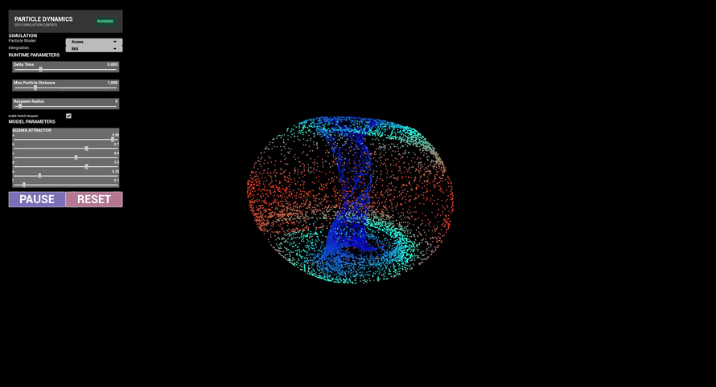
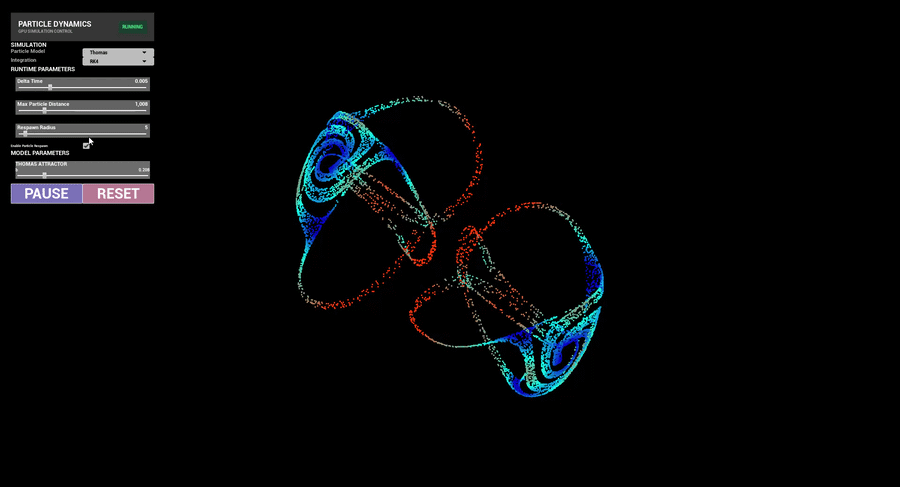
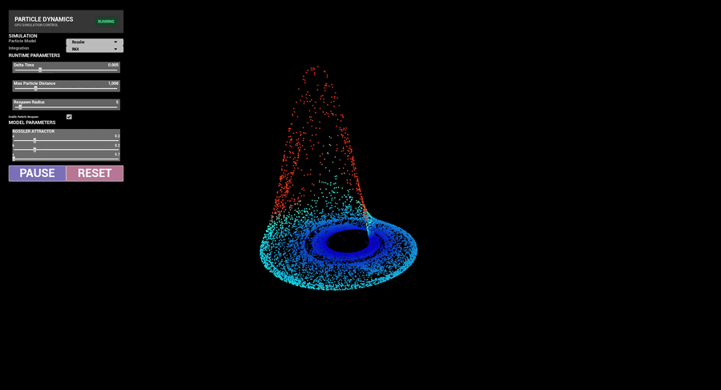
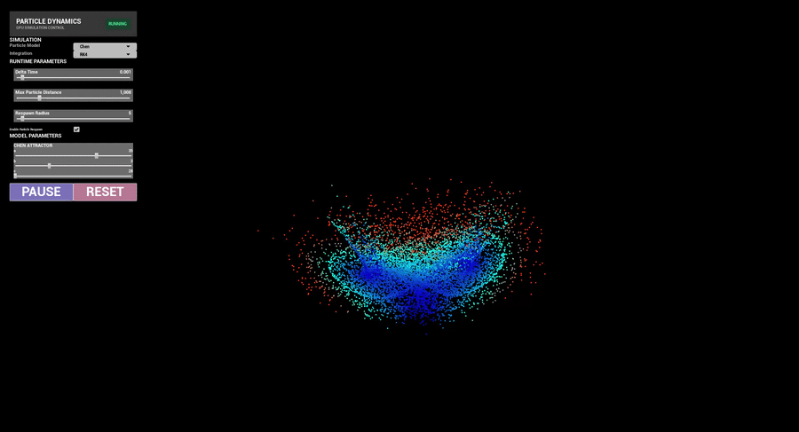
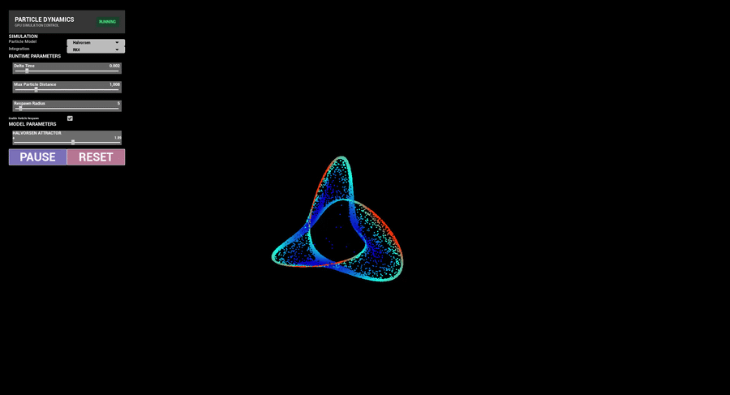
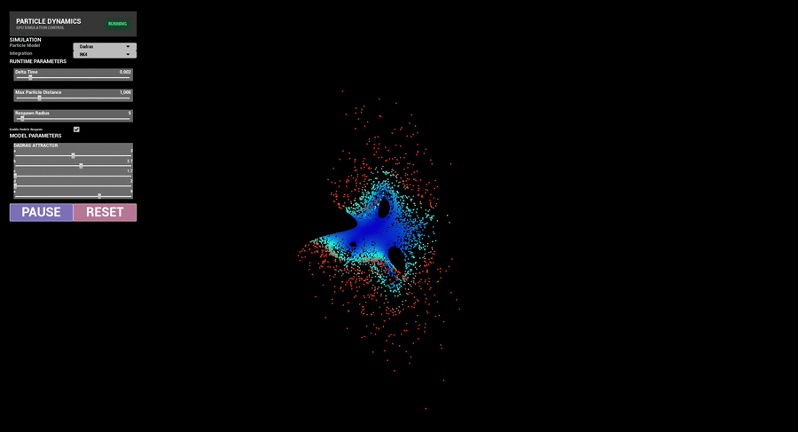

# ParticleDynamics
### GPU-Accelerated Nonlinear Dynamical Systems for Unreal Engine 5.8

**ParticleDynamics** is a GPU-accelerated particle simulation plugin developed for Unreal Engine 5.8. It provides a real-time environment for exploring and visualizing nonlinear dynamical systems through configurable mathematical models, numerical integration methods, and GPU-based particle computation.

Built with C++, HLSL, Unreal Engine's Rendering Hardware Interface (RHI), and Compute Shaders, the plugin combines mathematical simulation with real-time visualization in a modular and interactive environment.

---

## Overview

ParticleDynamics brings mathematical dynamical systems into Unreal Engine through a dedicated GPU simulation pipeline.

The simulation uses GPU compute shaders to perform particle state calculations and numerical integration. Simulation data is then processed by a dedicated rendering pipeline to visualize particle trajectories and dynamic behavior.

The architecture supports multiple mathematical models through a shared simulation framework, allowing users to switch between systems and adjust their parameters at runtime.

## Demonstrations

The following demonstrations showcase the eight implemented nonlinear dynamical systems.

### 1. Lorenz Attractor

The Lorenz system is a classic example of deterministic chaos, characterized by its distinctive butterfly-shaped attractor.

### 2. Aizawa Attractor

A nonlinear dynamical system known for its complex three-dimensional trajectories and intricate attractor structures.

### 3. Thomas Attractor

A cyclically symmetric nonlinear system that produces distinctive periodic and chaotic trajectories.

### 4. Rössler Attractor

A continuous-time chaotic system known for its characteristic spiral-shaped attractor.

### 5. Chen System

A three-dimensional nonlinear chaotic system exhibiting complex trajectories and sensitivity to initial conditions.

### 6. Halvorsen Attractor

A symmetric nonlinear system producing intricate three-dimensional chaotic structures.

### 7. Dadras System

A nonlinear dynamical system capable of generating complex chaotic attractor behavior.

### 8. Rabinovich–Fabrikant System

A nonlinear system exhibiting rich dynamical behavior, including complex and chaotic attractor structures.

---

## Key Features

- **GPU-Accelerated Simulation** – Particle state calculations are performed using GPU compute shaders.
- **Eight Dynamical Systems** – Multiple nonlinear mathematical models in one simulation framework.
- **Numerical Integration** – Euler and fourth-order Runge–Kutta (RK4) methods.
- **Runtime Parameter Control** – Adjust mathematical parameters while simulation is running.
- **Dynamic Model Switching** – Change between supported systems through the control interface.
- **Real-Time Particle Visualization** – Visualize evolving particle trajectories.
- **Velocity-Based Coloring** – Use particle velocity information to drive visual appearance.
- **GPU Data Readback** – Asynchronous infrastructure for accessing simulation data.
- **Simulation Reset** – Reset simulation state through runtime controls.

## Technical Architecture

### Simulation Management

Coordinates simulation initialization, GPU resource allocation, particle state buffers, and compute dispatch operations.

### Numerical Integration

Supports two numerical integration approaches:

- **Euler:** First-order numerical integration.
- **RK4:** Fourth-order Runge–Kutta integration.

### GPU Compute Pipeline

Uses Unreal Engine's shader infrastructure and GPU buffers to perform particle state calculations and iterative simulation updates.

### Particle Rendering

Processes simulation data through a dedicated rendering pipeline to visualize the resulting particle distributions and trajectories.

### Runtime Control Interface

An integrated UMG Widget Blueprint provides access to:

- Dynamical system selection
- Mathematical model parameters
- Integration method
- Simulation Delta Time
- Reset functionality
- Visualization controls

## Technology Stack

| Technology | Application |
|---|---|
| Unreal Engine 5.8 | Real-time simulation |
| C++ | Simulation architecture |
| HLSL / Unreal Shaders | GPU computation |
| Render Dependency Graph (RDG) | GPU scheduling and resource management |
| RHI | GPU resource handling |
| Compute Shaders | Particle state calculations |
| Blueprint / UMG | Runtime interface |
| Numerical Methods | Euler and RK4 |

## System Requirements

- Unreal Engine 5.8
- Windows 64-bit
- DirectX 12-compatible graphics hardware
- GPU support for the required shader and rendering features

Performance depends on GPU hardware, particle count, simulation settings, and rendering configuration.

## Commercial Availability

**ParticleDynamics is a proprietary commercial Unreal Engine plugin.**

This repository serves as a technical portfolio and project showcase. The complete implementation, source code, shaders, and distributable plugin are not publicly included.

The commercial product is intended for distribution through the Unreal Engine Fab marketplace.

## License

Copyright © 2026. All rights reserved.

The software implementation, proprietary source code, shaders, and associated commercial assets are not licensed for redistribution, modification, or commercial reuse through this portfolio repository.

Please refer to the commercial product's license and applicable Fab marketplace terms for usage rights.

---

**ParticleDynamics — Exploring nonlinear dynamics through real-time GPU computation.**
